# MongoDB Advanced Training Assignment

A comprehensive implementation of schema validation, advanced array queries and updates, bulk write operations, multi-stage aggregation pipelines, compound indexing (ESR), execution plan analysis, disaster recovery, and production architecture using `mongosh`.

## Overview
This repository contains the completed assignment for the **MongoDB (Advanced)** training module (Raja Software Labs). The objective is to demonstrate production-level proficiency in:
- Enforcing server-side document contracts with `$jsonSchema` validation
- Precision array querying and in-place updates using `$elemMatch`, positional `$`, and `arrayFilters`
- High-throughput write batching via `db.collection.bulkWrite()`
- Multi-collection data aggregation and multi-faceted analytics using `$lookup`, `$unwind`, and `$facet`
- Index engineering adhering to the **ESR rule** (Equality, Sort, Range) and query plan diagnostics via `explain("executionStats")`
- Automated document expiration via TTL indexing
- Logical backup creation (`mongodump`) and non-destructive isolated restoration (`mongorestore`) with namespace remapping
- Architectural mastery of MongoDB distributed systems (Replica Sets, Sharding, Consistency, Change Streams, and Security)

## Environment & Prerequisites
- **Database Engine:** MongoDB Community Server (v8.0+ / v6.0+)
- **Shell Interface:** MongoDB Shell (`mongosh` v2.0+)
- **Database Tools:** `mongodump`, `mongorestore` (MongoDB Database Tools)
- **Node.js / JavaScript Runtime:** v18+ (optional, for script execution)

## Repository Structure
```text
mongodb-advanced-assignment-sanketahire/
├── .gitignore                         # Ignored operating system, log, and archive artifacts
├── README.md                          # Project documentation, execution logs, and verification
├── mongodb-advanced-assignment.js     # Primary solution script for Tasks 1–5 (pure queries)
├── backup-restore-commands.txt        # Command-line execution instructions for Task 6
├── answers.md                         # Task 5.2 explain statistics and Task 7 MCQ assessments
├── screenshots/                       # Visual proof of successful execution
└── docs/                              # Assignment specifications and reference materials
    ├── Training.Assignment.Mongdb (Advance).pdf
    └── Training.Material.Mongdb (Advance).pdf
```

## Solution Delivery
The full assignment solution, queries, outputs, and visual execution artifacts are implemented in the `feature/mongodb-advanced-assignment` branch and submitted via Pull Request.

## How to Run the Solution Script

You can execute the entire assignment script [`mongodb-advanced-assignment.js`](mongodb-advanced-assignment.js) directly against your local MongoDB instance using any of the following methods:

### Method 1: Input Redirection via Terminal (Recommended)
Because the script begins with `use company_advanced;`, redirecting the file directly into `mongosh` executes all tasks sequentially while echoing both the queries and formatted terminal outputs:

```bash
# Navigate to the repository directory
cd /path/to/mongodb-advanced-assignment-sanketahire

# Execute via standard input redirection
mongosh < mongodb-advanced-assignment.js
```

### Method 2: Pass Script Directly to `mongosh`
Run the script as an argument to `mongosh`:

```bash
# Execute against the company_advanced database
mongosh company_advanced mongodb-advanced-assignment.js
```

*Or with an explicit connection string:*
```bash
mongosh "mongodb://127.0.0.1:27017/company_advanced" mongodb-advanced-assignment.js
```

### Method 3: Execute from within `mongosh` Shell
If you already have an active `mongosh` session:

```javascript
// 1. Switch to the company_advanced database
use company_advanced;

// 2. Load and run the script file
load("mongodb-advanced-assignment.js");
```

### Method 4: Interactive Step-by-Step Execution
Open the MongoDB Shell (`mongosh`) and execute the individual query blocks step-by-step as documented in the task-by-task sections below.

---

## Task-by-Task Implementation & Verification

### Task 1: Schema Validation and Data Creation

#### Step 1: Select Database & Clean Slate Reset
Switch to the fresh `company_advanced` database and ensure a clean slate.

⚡ **Input Command:**
```javascript
use company_advanced;
db.employees.drop();
```
🖥️ **Terminal Output:**
```text
switched to db company_advanced
true
```

#### Step 2: Create the Validated Collection with `$jsonSchema`
Create the `employees` collection with strict schema validation enforcing:
- `name`: string
- `departmentId`: int
- `experience`: int
- `active`: bool

⚡ **Input Command:**
```javascript
db.createCollection("employees", {
  validator: {
    $jsonSchema: {
      bsonType: "object",
      required: ["name", "departmentId", "experience", "active"],
      properties: {
        name: {
          bsonType: "string",
          description: "must be a string and is required"
        },
        departmentId: {
          bsonType: "int",
          description: "must be an integer and is required"
        },
        experience: {
          bsonType: "int",
          description: "must be an integer and is required"
        },
        active: {
          bsonType: "bool",
          description: "must be a boolean and is required"
        }
      }
    }
  }
});
```
🖥️ **Terminal Output:**
```json
{
  "ok": 1
}
```

#### Step 3: Insert the Starting Dataset
Insert the three baseline employee documents (John, Alice, David) using `NumberInt()` for integer fields.

⚡ **Input Command:**
```javascript
db.employees.insertMany([
  {
    _id: 1,
    name: "John",
    departmentId: NumberInt(10),
    skills: ["Java", "MongoDB"],
    experience: NumberInt(4),
    active: true,
    certifications: [
      { name: "MongoDB", status: "Expired", expiryYear: NumberInt(2026) }
    ]
  },
  {
    _id: 2,
    name: "Alice",
    departmentId: NumberInt(10),
    skills: ["Python", "MongoDB"],
    experience: NumberInt(6),
    active: true,
    certifications: [
      { name: "MongoDB", status: "Active", expiryYear: NumberInt(2028) }
    ]
  },
  {
    _id: 3,
    name: "David",
    departmentId: NumberInt(20),
    skills: ["Communication"],
    experience: NumberInt(3),
    active: false,
    certifications: [
      { name: "Communication", status: "Active", expiryYear: NumberInt(2027) }
    ]
  }
]);
```
🖥️ **Terminal Output:**
```json
{
  "acknowledged": true,
  "insertedIds": {
    "0": 1,
    "1": 2,
    "2": 3
  }
}
```

#### Step 4: Test Schema Validation with Invalid Document
Attempt to insert an invalid document (`_id: 99`) containing mismatched types (`name` as integer, `departmentId` as string `"HR"`, `experience` as string `"one"`, `active` as string `"yes"`).

⚡ **Input Command:**
```javascript
db.employees.insertOne({
  _id: 99,
  name: 123,
  departmentId: "HR",
  experience: "one",
  active: "yes"
});
```
🖥️ **Terminal Output:**
```text
MongoServerError: Document failed validation
Additional information: {
  failingDocumentId: 99,
  details: {
    operatorName: '$jsonSchema',
    schemaRulesNotSatisfied: [
      {
        operatorName: 'properties',
        propertiesNotSatisfied: [
          { propertyName: 'name', reason: 'type did not match', consideredValue: 123, consideredType: 'int' },
          { propertyName: 'departmentId', reason: 'type did not match', consideredValue: 'HR', consideredType: 'string' },
          { propertyName: 'experience', reason: 'type did not match', consideredValue: 'one', consideredType: 'string' },
          { propertyName: 'active', reason: 'type did not match', consideredValue: 'yes', consideredType: 'string' }
        ]
      }
    ]
  }
}
```

#### Step 5: Verify Collection Document Count
Confirm that the collection contains strictly the 3 valid documents.

⚡ **Input Command:**
```javascript
db.employees.countDocuments();
```
🖥️ **Terminal Output:**
```text
3
```

#### Visual Execution Proof:
* **Setup, Collection Creation & Seed Insertion:**  
  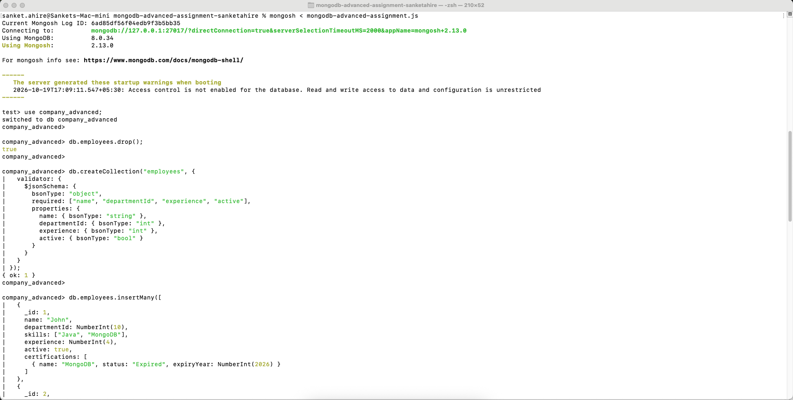
* **Schema Validation Failure (Negative Test):**  
  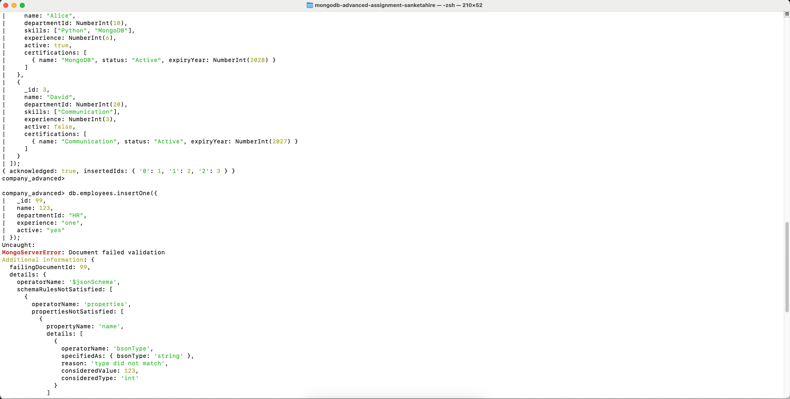
* **Validation Details & Document Count Verification:**  
  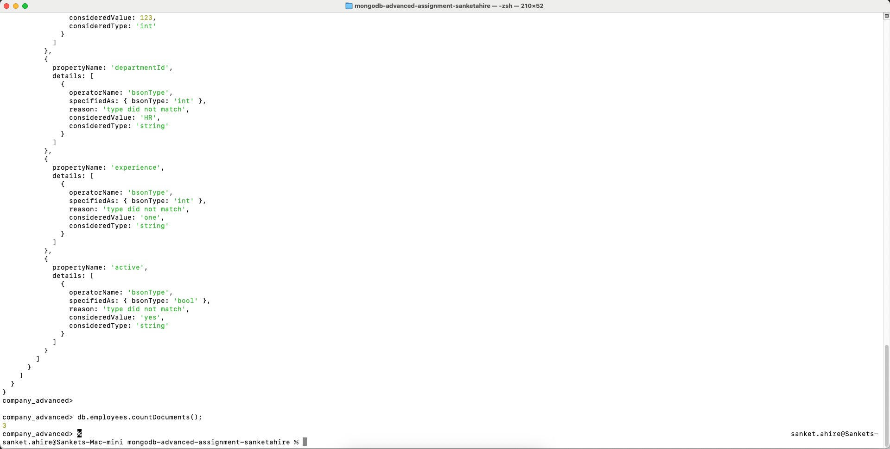

---

### Task 2: Advanced Array Queries and Updates

#### 2.1 Find One Matching Array Object with `$elemMatch`
Find employees whose `certifications` contain the same subdocument object with `name: "MongoDB"` and `status: "Active"`. Using `$elemMatch` ensures both conditions match the same array element.

⚡ **Input Command:**
```javascript
db.employees.find({
  certifications: {
    $elemMatch: { name: "MongoDB", status: "Active" }
  }
});
```
🖥️ **Terminal Output:**
```json
[
  {
    "_id": 2,
    "name": "Alice",
    "departmentId": 10,
    "skills": [
      "Python",
      "MongoDB"
    ],
    "experience": 6,
    "active": true,
    "certifications": [
      {
        "name": "MongoDB",
        "status": "Active",
        "expiryYear": 2028
      }
    ]
  }
]
```

#### 2.2 Update One Matching Array Element using Positional `$` Operator
Update John's MongoDB certification status from `"Expired"` to `"Active"`. The positional `$` operator identifies and mutates the first array element matching the query predicate.

⚡ **Input Command:**
```javascript
db.employees.updateOne(
  { _id: 1, "certifications.name": "MongoDB" },
  { $set: { "certifications.$.status": "Active" } }
);
```
🖥️ **Terminal Output:**
```json
{
  "acknowledged": true,
  "insertedId": null,
  "matchedCount": 1,
  "modifiedCount": 1,
  "upsertedCount": 0
}
```

**Verification:**
⚡ **Input Command:**
```javascript
db.employees.findOne({ _id: 1 }, { name: 1, certifications: 1 });
```
🖥️ **Terminal Output:**
```json
{
  "_id": 1,
  "name": "John",
  "certifications": [
    {
      "name": "MongoDB",
      "status": "Active",
      "expiryYear": 2026
    }
  ]
}
```

#### 2.3 Update Selected Array Elements using `arrayFilters`
Update the certification status to `"Renewal Due"` for certification elements whose `expiryYear` is strictly less than 2027 (`$lt: 2027`).

⚡ **Input Command:**
```javascript
db.employees.updateOne(
  { _id: 1 },
  { $set: { "certifications.$[c].status": "Renewal Due" } },
  { arrayFilters: [{ "c.expiryYear": { $lt: 2027 } }] }
);
```
🖥️ **Terminal Output:**
```json
{
  "acknowledged": true,
  "insertedId": null,
  "matchedCount": 1,
  "modifiedCount": 1,
  "upsertedCount": 0
}
```

**Verification:**
⚡ **Input Command:**
```javascript
db.employees.findOne({ _id: 1 }, { name: 1, certifications: 1 });
```
🖥️ **Terminal Output:**
```json
{
  "_id": 1,
  "name": "John",
  "certifications": [
    {
      "name": "MongoDB",
      "status": "Renewal Due",
      "expiryYear": 2026
    }
  ]
}
```

#### Step 4: Verification of Final Required Certification Values
Verify that Alice's certification remains `"Active"` and John's certification is updated to `"Renewal Due"`.

⚡ **Input Command:**
```javascript
db.employees.find({}, { name: 1, certifications: 1 });
```
🖥️ **Terminal Output:**
```json
[
  {
    "_id": 1,
    "name": "John",
    "certifications": [
      {
        "name": "MongoDB",
        "status": "Renewal Due",
        "expiryYear": 2026
      }
    ]
  },
  {
    "_id": 2,
    "name": "Alice",
    "certifications": [
      {
        "name": "MongoDB",
        "status": "Active",
        "expiryYear": 2028
      }
    ]
  },
  {
    "_id": 3,
    "name": "David",
    "certifications": [
      {
        "name": "Communication",
        "status": "Active",
        "expiryYear": 2027
      }
    ]
  }
]
```

#### Visual Execution Proof:
* **$elemMatch Query & Positional Update Cross-Verification:**  
  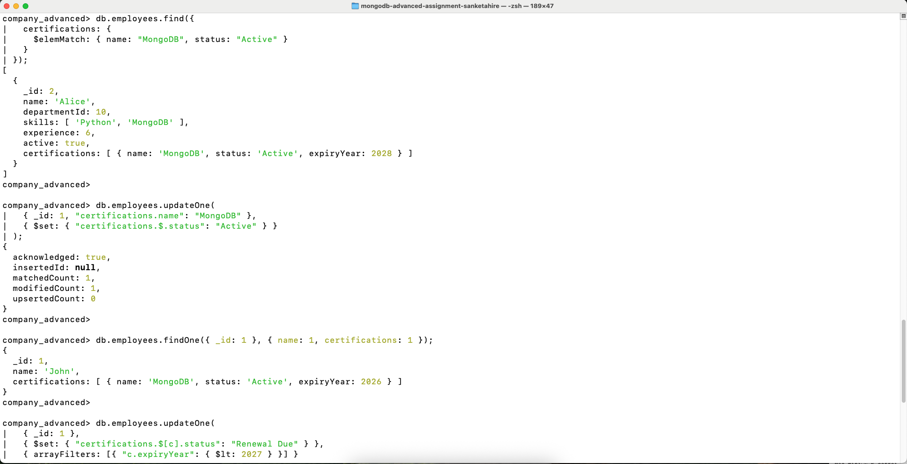
* **arrayFilters Update & Final Certification Verification:**  
  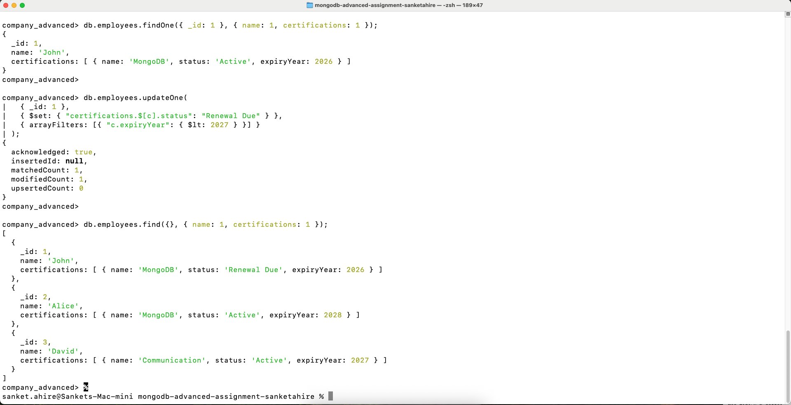

---

### Task 3: Bulk Write Operations

#### Step 1: Execute Single `bulkWrite()` Call
Execute three distinct write operations in one batch via `db.employees.bulkWrite()`:
1. Increment John's experience by 1 using `$inc`.
2. Set Alice's `active` field to `false` using `$set`.
3. Insert Emma using `insertOne` with strict BSON integer typing.

⚡ **Input Command:**
```javascript
db.employees.bulkWrite([
  {
    updateOne: {
      filter: { name: "John" },
      update: { $inc: { experience: NumberInt(1) } }
    }
  },
  {
    updateOne: {
      filter: { name: "Alice" },
      update: { $set: { active: false } }
    }
  },
  {
    insertOne: {
      document: {
        _id: 4,
        name: "Emma",
        departmentId: NumberInt(20),
        skills: ["Excel"],
        experience: NumberInt(2),
        active: true,
        certifications: [
          { name: "Excel", status: "Active", expiryYear: NumberInt(2026) }
        ]
      }
    }
  }
]);
```
🖥️ **Terminal Output:**
```json
{
  "acknowledged": true,
  "insertedCount": 1,
  "insertedIds": {
    "2": 4
  },
  "matchedCount": 2,
  "modifiedCount": 2,
  "deletedCount": 0,
  "upsertedCount": 0,
  "upsertedIds": {}
}
```

#### Step 2: Verification of Final Collection State

##### Verification 1: John's Experience Incremented (4 → 5)
⚡ **Input Command:**
```javascript
db.employees.findOne({ name: "John" });
```
🖥️ **Terminal Output:**
```json
{
  "_id": 1,
  "name": "John",
  "departmentId": 10,
  "skills": [
    "Java",
    "MongoDB"
  ],
  "experience": 5,
  "active": true,
  "certifications": [
    {
      "name": "MongoDB",
      "status": "Renewal Due",
      "expiryYear": 2026
    }
  ]
}
```

##### Verification 2: Alice's Active Status Updated (true → false)
⚡ **Input Command:**
```javascript
db.employees.findOne({ name: "Alice" });
```
🖥️ **Terminal Output:**
```json
{
  "_id": 2,
  "name": "Alice",
  "departmentId": 10,
  "skills": [
    "Python",
    "MongoDB"
  ],
  "experience": 6,
  "active": false,
  "certifications": [
    {
      "name": "MongoDB",
      "status": "Active",
      "expiryYear": 2028
    }
  ]
}
```

##### Verification 3: Total Employee Document Count (3 → 4)
⚡ **Input Command:**
```javascript
db.employees.countDocuments();
```
🖥️ **Terminal Output:**
```text
4
```

#### Visual Execution Proof:
* **Bulk Write Batch Execution & Acknowledgment:**  
  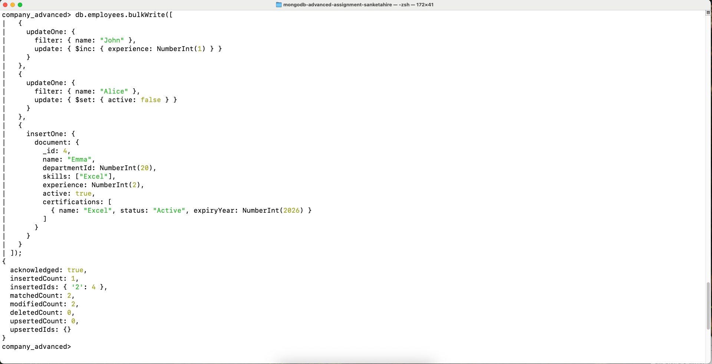
* **Final State Verification (John Experience, Alice Active, Total Count):**  
  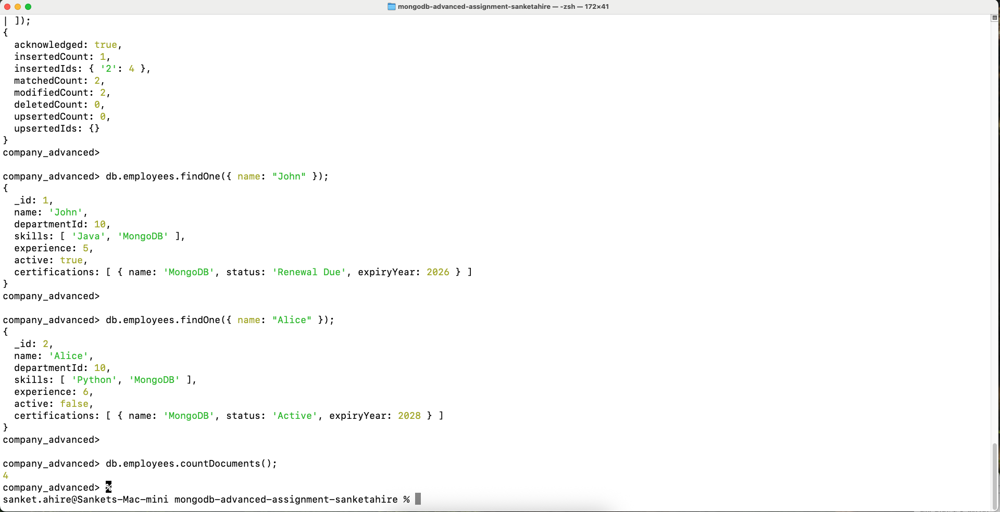

---

### Task 4: Advanced Aggregation

#### Step 1: Create the Departments Collection
Create and seed the `departments` collection with Engineering and HR records using `NumberInt()` for integer identifiers.

⚡ **Input Command:**
```javascript
db.departments.drop();
db.departments.insertMany([
  { _id: NumberInt(10), name: "Engineering" },
  { _id: NumberInt(20), name: "HR" }
]);
```
🖥️ **Terminal Output:**
```json
{
  "acknowledged": true,
  "insertedIds": {
    "0": 10,
    "1": 20
  }
}
```

#### 4.1 Join Employees with Departments
Build an aggregation pipeline that performs a left outer join between `employees.departmentId` and `departments._id`, flattens the joined array with `$unwind`, projects **only** employee `name` and `departmentName` (suppressing `_id`), and sorts by employee `name` in ascending order.

⚡ **Input Command:**
```javascript
db.employees.aggregate([
  {
    $lookup: {
      from: "departments",
      localField: "departmentId",
      foreignField: "_id",
      as: "department"
    }
  },
  { $unwind: "$department" },
  {
    $project: {
      _id: 0,
      name: 1,
      departmentName: "$department.name"
    }
  },
  { $sort: { name: 1 } }
]);
```
🖥️ **Terminal Output:**
```json
[
  {
    "name": "Alice",
    "departmentName": "Engineering"
  },
  {
    "name": "David",
    "departmentName": "HR"
  },
  {
    "name": "Emma",
    "departmentName": "HR"
  },
  {
    "name": "John",
    "departmentName": "Engineering"
  }
]
```

**Verification:**  
Confirm that every single employee in the collection was successfully matched and joined (count = 4):

⚡ **Input Command:**
```javascript
db.employees.aggregate([
  {
    $lookup: {
      from: "departments",
      localField: "departmentId",
      foreignField: "_id",
      as: "department"
    }
  },
  { $unwind: "$department" },
  { $count: "totalJoinedEmployees" }
]);
```
🖥️ **Terminal Output:**
```json
[
  {
    "totalJoinedEmployees": 4
  }
]
```

#### 4.2 Count Employees for Each Skill
Deconstruct the `skills` array using `$unwind`, group by individual skill with `$sum: 1` accumulator, sort by `employeeCount` descending, and apply an ascending alphabetical tie-breaker on the skill name (`_id: 1`) for deterministic ordering when counts match.

⚡ **Input Command:**
```javascript
db.employees.aggregate([
  { $unwind: "$skills" },
  {
    $group: {
      _id: "$skills",
      employeeCount: { $sum: 1 }
    }
  },
  { $sort: { employeeCount: -1, _id: 1 } }
]);
```
🖥️ **Terminal Output:**
```json
[
  {
    "_id": "MongoDB",
    "employeeCount": 2
  },
  {
    "_id": "Communication",
    "employeeCount": 1
  },
  {
    "_id": "Excel",
    "employeeCount": 1
  },
  {
    "_id": "Java",
    "employeeCount": 1
  },
  {
    "_id": "Python",
    "employeeCount": 1
  }
]
```

#### 4.3 Return Active Employees and a Count ($facet)
Use `$facet` to execute two parallel sub-pipelines in a single database round-trip across filtered active employees (`active: true`):
1. `activeEmployees`: Projects employee names sorted alphabetically in ascending order.
2. `totalCount`: Returns the total count of active employees (`$count: "activeEmployees"` = 2, representing John and Emma, since Alice was set to inactive in Task 3 and David is inactive).

⚡ **Input Command:**
```javascript
db.employees.aggregate([
  { $match: { active: true } },
  {
    $facet: {
      activeEmployees: [
        { $sort: { name: 1 } },
        { $project: { _id: 0, name: 1 } }
      ],
      totalCount: [
        { $count: "activeEmployees" }
      ]
    }
  }
]);
```
🖥️ **Terminal Output:**
```json
[
  {
    "activeEmployees": [
      {
        "name": "Emma"
      },
      {
        "name": "John"
      }
    ],
    "totalCount": [
      {
        "activeEmployees": 2
      }
    ]
  }
]
```

#### Visual Execution Proof:
* **Department Lookup, Unwind & Sort (4.1):**  
  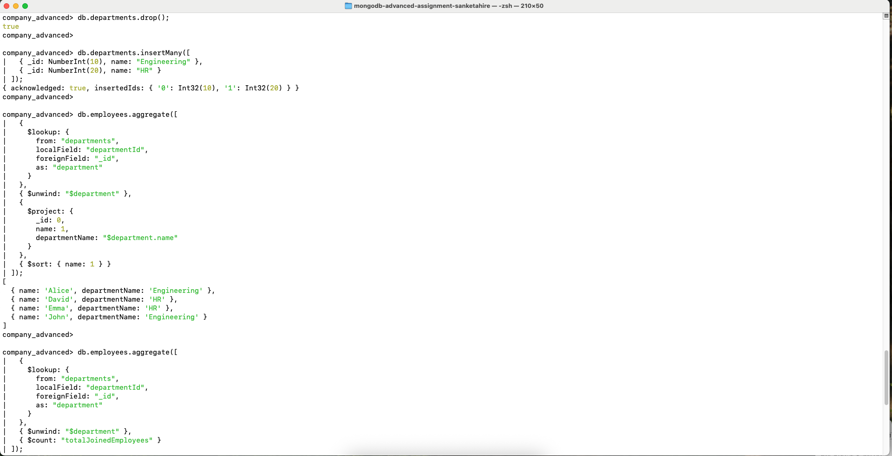
* **Skill Counts with Secondary Tie-Breaker & Facet Active Count (4.2 & 4.3):**  
  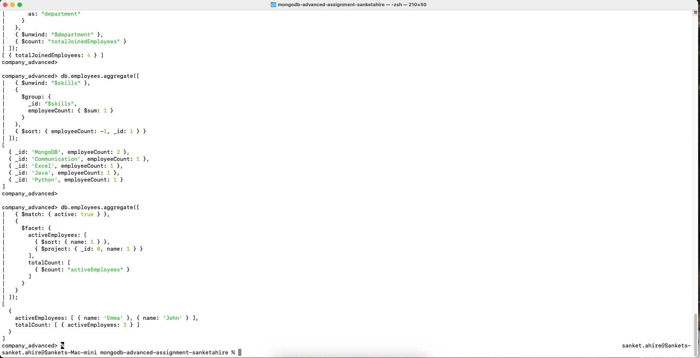

---

### Task 5: Indexing and Query Performance

#### 5.1 Create and Verify a Compound Index
Create an ascending compound index on `departmentId` followed by `name` (`{ departmentId: 1, name: 1 }`), explicitly named `departmentId_1_name_1`. Verify its creation using `getIndexes()`.

⚡ **Input Command:**
```javascript
db.employees.createIndex(
  { departmentId: 1, name: 1 },
  { name: "departmentId_1_name_1" }
);

db.employees.getIndexes();
```
🖥️ **Terminal Output:**
```json
[
  {
    "v": 2,
    "key": {
      "_id": 1
    },
    "name": "_id_"
  },
  {
    "v": 2,
    "key": {
      "departmentId": 1,
      "name": 1
    },
    "name": "departmentId_1_name_1"
  }
]
```

#### 5.2 Read `explain("executionStats")`
Execute `explain("executionStats")` for the query filtering by `departmentId: 10` and sorted by `name: 1`.

⚡ **Input Command:**
```javascript
db.employees
  .find({ departmentId: 10 })
  .sort({ name: 1 })
  .explain("executionStats");
```
🖥️ **Terminal Output (`explain("executionStats")`):**
```json
{
  "explainVersion": "1",
  "queryPlanner": {
    "namespace": "company_advanced.employees",
    "parsedQuery": {
      "departmentId": {
        "$eq": 10
      }
    },
    "indexFilterSet": false,
    "winningPlan": {
      "stage": "FETCH",
      "inputStage": {
        "stage": "IXSCAN",
        "keyPattern": {
          "departmentId": 1,
          "name": 1
        },
        "indexName": "departmentId_1_name_1",
        "isMultiKey": false,
        "direction": "forward",
        "indexBounds": {
          "departmentId": [
            "[10, 10]"
          ],
          "name": [
            "[MinKey, MaxKey]"
          ]
        }
      }
    }
  },
  "executionStats": {
    "executionSuccess": true,
    "nReturned": 2,
    "executionTimeMillis": 0,
    "totalKeysExamined": 2,
    "totalDocsExamined": 2,
    "executionStages": {
      "stage": "FETCH",
      "nReturned": 2,
      "executionTimeMillisEstimate": 0,
      "docsExamined": 2,
      "inputStage": {
        "stage": "IXSCAN",
        "nReturned": 2,
        "executionTimeMillisEstimate": 0,
        "keyPattern": {
          "departmentId": 1,
          "name": 1
        },
        "indexName": "departmentId_1_name_1",
        "direction": "forward",
        "keysExamined": 2,
        "seeks": 1
      }
    }
  }
}
```

##### Recorded Task 5.2 Metrics for [`answers.md`](answers.md):
- **winning plan stage:** `IXSCAN` (under `FETCH` using index `departmentId_1_name_1`)
- **nReturned:** `2`
- **totalDocsExamined:** `2`
- **totalKeysExamined:** `2`

#### 5.3 Create a TTL Index on `sessions`
Create the `sessions` collection, insert a session document expiring in 10 minutes (`Date.now() + 600000`), and create a TTL index on `expiresAt` with `expireAfterSeconds: 0`, named `expiresAt_1`.

⚡ **Input Command:**
```javascript
db.sessions.drop();

db.sessions.insertOne({
  _id: 1,
  userName: "John",
  expiresAt: new Date(Date.now() + 600000)
});

db.sessions.createIndex(
  { expiresAt: 1 },
  { expireAfterSeconds: 0, name: "expiresAt_1" }
);

db.sessions.getIndexes();
```
🖥️ **Terminal Output:**
```json
[
  {
    "v": 2,
    "key": {
      "_id": 1
    },
    "name": "_id_"
  },
  {
    "v": 2,
    "key": {
      "expiresAt": 1
    },
    "name": "expiresAt_1",
    "expireAfterSeconds": 0
  }
]
```

#### Visual Execution Proof:
* **Compound Index Creation & Winning Plan Inspection (5.1 & 5.2):**  
  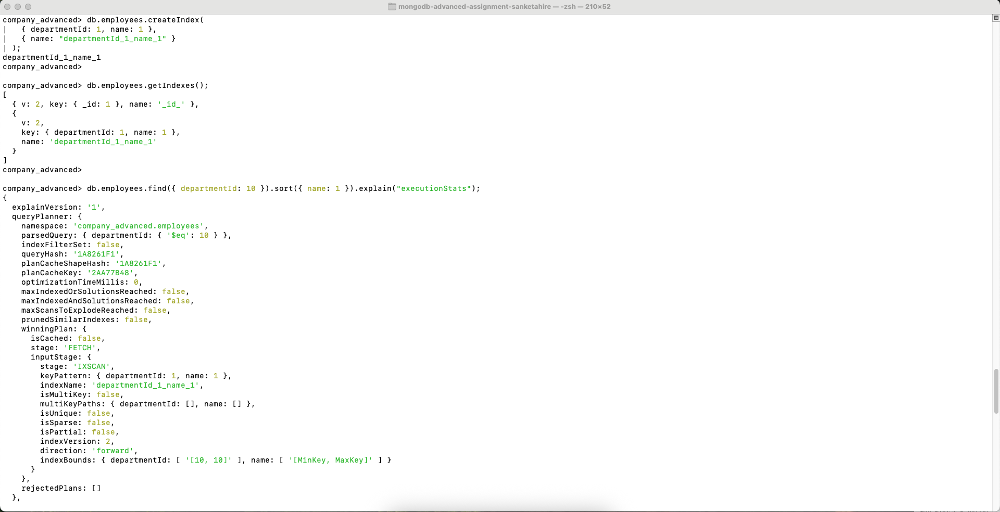
* **ExecutionStats Metrics Inspection (5.2):**  
  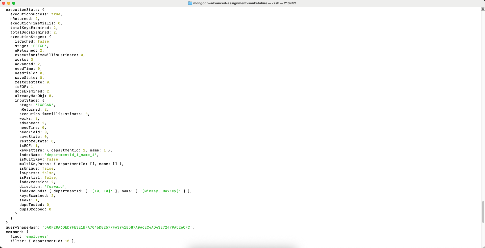
* **TTL Collection, Document & Index Verification (5.3):**  
  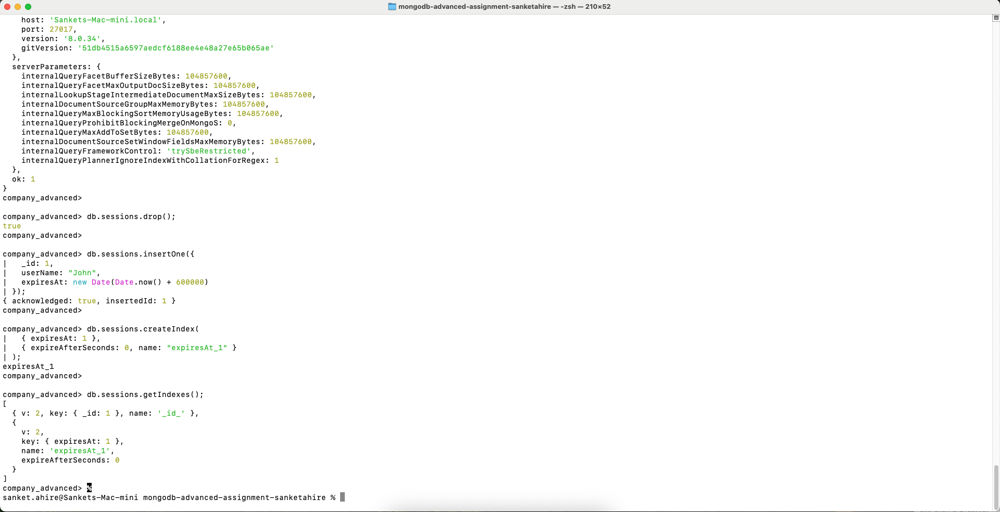

---

### Task 6: Backup and Restore

#### Step 1: Create a Logical Compressed Backup with `mongodump`
Back up the `company_advanced` database to a gzip-compressed archive file named `company_advanced.archive`.

⚡ **Input Command:**
```bash
mongodump --db company_advanced --archive=company_advanced.archive --gzip
```
🖥️ **Terminal Output:**
```text
writing `company_advanced.departments` to "archive `company_advanced.archive`"
writing `company_advanced.employees` to "archive `company_advanced.archive`"
writing `company_advanced.sessions` to "archive `company_advanced.archive`"
done dumping `company_advanced.departments` (2 documents)
done dumping `company_advanced.sessions` (1 document)
done dumping `company_advanced.employees` (4 documents)
```

#### Step 2: Restore into New Database with Namespace Remapping
Restore the compressed archive into a new, isolated database named `company_advanced_restore` using `--nsFrom` and `--nsTo`. This safeguards the original working database from being overwritten.

⚡ **Input Command:**
```bash
mongorestore --archive=company_advanced.archive --gzip \
  --nsFrom="company_advanced.*" \
  --nsTo="company_advanced_restore.*"
```
🖥️ **Terminal Output:**
```text
preparing collections to restore from
reading metadata for `company_advanced_restore.sessions` from "archive `company_advanced.archive`"
reading metadata for `company_advanced_restore.departments` from "archive `company_advanced.archive`"
reading metadata for `company_advanced_restore.employees` from "archive `company_advanced.archive`"
restoring `company_advanced_restore.departments` from "archive `company_advanced.archive`"
finished restoring `company_advanced_restore.departments` (2 documents, 0 failures)
restoring `company_advanced_restore.sessions` from "archive `company_advanced.archive`"
finished restoring `company_advanced_restore.sessions` (1 document, 0 failures)
restoring `company_advanced_restore.employees` from "archive `company_advanced.archive`"
finished restoring `company_advanced_restore.employees` (4 documents, 0 failures)
restoring indexes for collection `company_advanced_restore.sessions` from metadata
index: expiresAt_1
restoring indexes for collection `company_advanced_restore.employees` from metadata
index: departmentId_1_name_1
7 document(s) restored successfully. 0 document(s) failed to restore.
```

#### Step 3: Verify Restored Collection Counts in `mongosh`
Assert that all 3 collections and their respective document counts were restored intact in `company_advanced_restore`.

⚡ **Input Command:**
```javascript
use company_advanced_restore;
show collections;
db.employees.countDocuments();
db.departments.countDocuments();
db.sessions.countDocuments();
```
🖥️ **Terminal Output:**
```text
switched to db company_advanced_restore
departments
employees
sessions
4
2
1
```

#### Step 4: Verify Original Working Database Integrity
Assert that the original `company_advanced` database was completely untouched and preserved.

⚡ **Input Command:**
```javascript
use company_advanced;
db.employees.countDocuments();
```
🖥️ **Terminal Output:**
```text
switched to db company_advanced
4
```

#### Visual Execution Proof:
* **Backup and Remapped Restore Execution:**  
  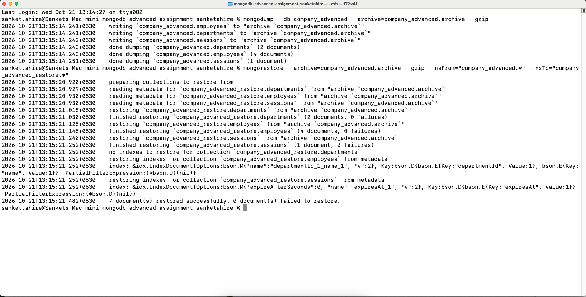
* **Restored Database Collection Counts Verification:**  
  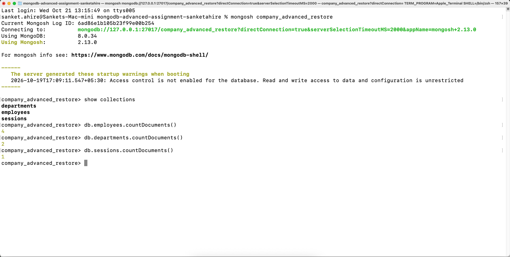

---

### Task 7: MongoDB Advanced Concepts — MCQs

The theoretical assessment evaluates production concepts across distributed transactions, replication durability, automated failover, horizontal sharding, real-time change events, and defense-in-depth security. Full detailed justifications are documented in [`answers.md`](answers.md).

#### Executive Answer Key

| Question # | Core Topic Area | Correct Answer | Key Concept Summary |
| :---: | :--- | :---: | :--- |
| **Q1** | Schema Validation | **B** | Enforces data integrity by rejecting documents violating field types/schemas. |
| **Q2** | Array Query Operators (`$elemMatch`) | **B** | Ensures multiple query criteria match against the *same* embedded array object. |
| **Q3** | Filtered Array Updates (`arrayFilters`) | **C** | Selectively updates array elements that satisfy specific conditional criteria. |
| **Q4** | Bulk Operations (`bulkWrite`) | **A** | Combines multiple write operations into a single round-trip network payload. |
| **Q5** | Aggregation Pipeline Stages (`$lookup`) | **C** | Performs left outer joins to pull related documents from another collection. |
| **Q6** | Execution Plan Diagnostics (`IXSCAN`) | **B** | Indicates the query planner leveraged an index B-tree rather than a `COLLSCAN`. |
| **Q7** | Multi-Document Transactions (`abortTransaction`) | **C** | Aborts transactional batch and rolls back uncommitted writes atomically. |
| **Q8** | Replica Set Durability (`w: "majority"`) | **B** | Guarantees write acknowledgement across majority of voting data-bearing members. |
| **Q9** | High Availability & Failover | **C** | Eligible replica set secondaries automatically elect a new Primary node. |
| **Q10** | Sharding Strategy (Shard Key) | **B** | Requires high cardinality and uniform distribution to prevent jumbo chunks and hotspots. |
| **Q11** | Real-Time Events (Change Streams) | **A** | Applications listen in real time to database mutations (inserts, updates, deletes) via oplog. |
| **Q12** | Production Security Hardening | **C** | Hardens database using TLS encryption, restricted network access, and least privilege. |

---

## 📦 Submission Deliverables Audit Matrix

All required deliverables specified in the assignment prompt have been implemented, strictly formatted, and verified against our local MongoDB `8.0.34` environment:

| Deliverable # | Required Item / File | Description & Compliance Status | File Link |
| :---: | :--- | :--- | :---: |
| **1** | Pure JavaScript Queries | Pure executable `mongosh` queries for Tasks 1–5 without wrappers or comments. | [`mongodb-advanced-assignment.js`](mongodb-advanced-assignment.js) |
| **2** | Backup & Restore Commands | Exact CLI syntax for logical gzip archive backup and namespace-remapped restore. | [`backup-restore-commands.txt`](backup-restore-commands.txt) |
| **3** | Assessment Answers & Metrics | Live machine `explain("executionStats")` metrics (Task 5.2) + All 12 MCQs with justifications (Task 7). | [`answers.md`](answers.md) |
| **4** | Visual Proof Screenshots | 14 high-resolution terminal captures documenting every task step and count verification. | [`screenshots/`](screenshots/) |
| **5** | Git Branch & Pull Request | Feature branch `feature/mongodb-advanced-assignment` with clean atomic commits. | GitHub Branch |
| **6** | Status Updates | Midpoint update (Task 1) and final completion handoff report for mentor/lead submission. | Prepared for Submission |

---

## 📸 Complete Visual Evidence Index

| Screenshot ID | Assignment Task | Visual Verification Target | File Link |
| :---: | :--- | :--- | :---: |
| `01a` | Task 1: Setup & Seed | Clean database creation and initial 3 employee insertions | [`01a_setup_and_seed.png`](screenshots/01a_setup_and_seed.png) |
| `01b` | Task 1: Schema Rejection | Document `_id: 99` rejection with `DocumentValidationFailure` | [`01b_validation_failure.png`](screenshots/01b_validation_failure.png) |
| `01c` | Task 1: Count Verification | Exact count verification of 3 valid employees | [`01c_count_verification.png`](screenshots/01c_count_verification.png) |
| `02a` | Task 2: `$elemMatch` & Positional `$` | Query matching Alice and updating John's cert to `Active` | [`02a_array_match_and_positional_update.png`](screenshots/02a_array_match_and_positional_update.png) |
| `02b` | Task 2: `arrayFilters` | Batch updating certs `< 2027` to `Renewal Due` | [`02b_array_filters_and_verification.png`](screenshots/02b_array_filters_and_verification.png) |
| `03a` | Task 3: `bulkWrite()` Execution | Single atomic call executing 2 updates and 1 insert | [`03a_bulk_write_execution.png`](screenshots/03a_bulk_write_execution.png) |
| `03b` | Task 3: Bulk Verification | Validating John experience=5, Alice active=false, total count=4 | [`03b_bulk_write_verification.png`](screenshots/03b_bulk_write_verification.png) |
| `04a` | Task 4: `$lookup` & `$unwind` | Cross-collection join with departments, sorted by employee name | [`04a_department_join.png`](screenshots/04a_department_join.png) |
| `04b` | Task 4: Skills & `$facet` | Skill counts with tie-breaker and faceted active employee pagination | [`04b_skills_and_facet_aggregation.png`](screenshots/04b_skills_and_facet_aggregation.png) |
| `05a` | Task 5: Compound Index | Creation and verification of `departmentId_1_name_1` index | [`05a_compound_index_and_winning_plan.png`](screenshots/05a_compound_index_and_winning_plan.png) |
| `05b` | Task 5: Execution Stats | Winning plan `IXSCAN` and optimal $2:2:2$ metric ratio | [`05b_execution_stats_metrics.png`](screenshots/05b_execution_stats_metrics.png) |
| `05c` | Task 5: TTL Index | Creation and verification of `expiresAt_1` TTL index on `sessions` | [`05c_ttl_index_verification.png`](screenshots/05c_ttl_index_verification.png) |
| `06a` | Task 6: Backup & Remapped Restore | Logical gzip archive dump and namespace-remapped restore (`0 failures`) | [`06a_dump_and_restore.png`](screenshots/06a_dump_and_restore.png) |
| `06b` | Task 6: Restored Counts Verification | Count verification in `company_advanced_restore` (`4`, `2`, `1`) | [`06b_restored_collection_counts.png`](screenshots/06b_restored_collection_counts.png) |


